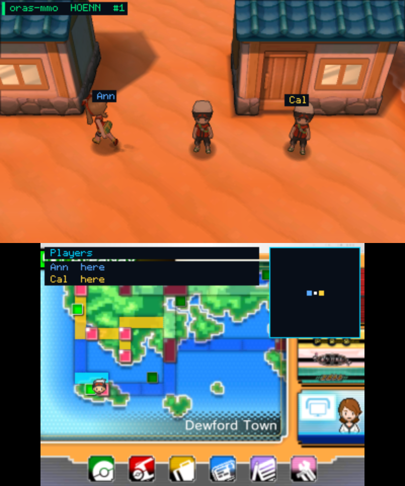
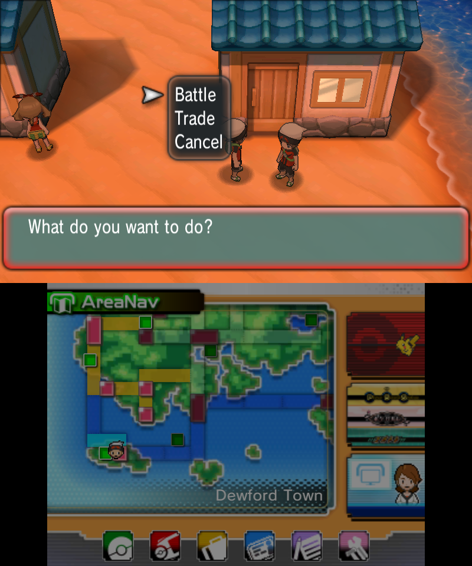
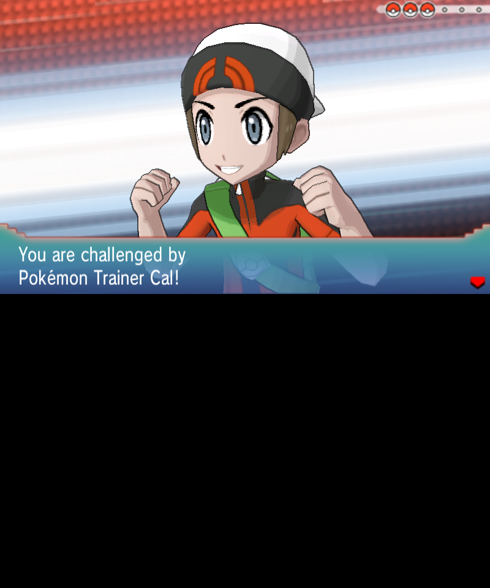
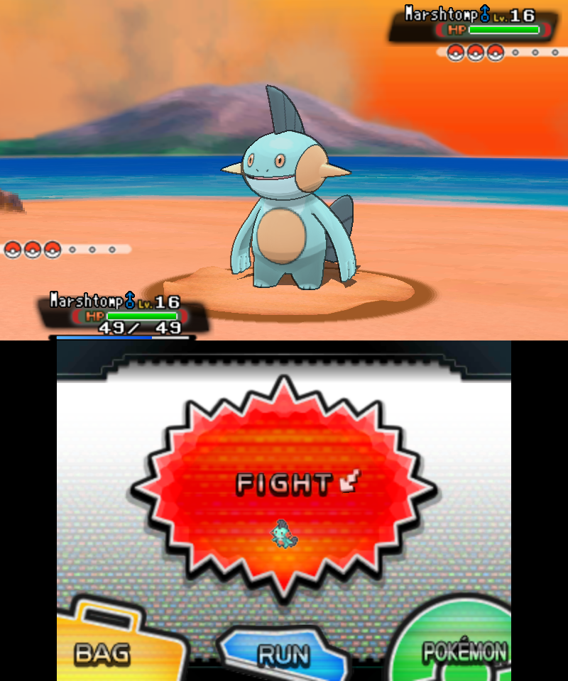

# ORAS MMO

**Play Pokémon Alpha Sapphire online with your friends, all in the same Hoenn.**

ORAS MMO is a mod for Pokémon Alpha Sapphire on the [Azahar](https://azahar-emu.org) emulator.
Everyone plays their own game, and everyone sees everyone else walking around in it, as real
trainers, in real time.

<p align="center">
  
  
</p>
<p align="center">
  
  
</p>

## What you can do

- **See each other.** Friends show up as their own trainer (Brendan, May or whatever outfit they
  wear), walking, running, biking and surfing next to you, with their name above their head.
- **Talk to each other.** Walk up to a friend and press **A**. Their greeting opens in the game's
  own text box.
- **Battle a friend's team.** Pick **Battle** and you fight their real party, under their name.
  Losing is fine: your party and money are put back afterwards.
- **Live battles.** Pick **Live battle** and your friend gets the challenge in their game. Say Yes
  and you battle each other for real: each of you picks your own moves, switches and items, and
  both games play out the same battle. Both teams are healed first, there's no EXP, and your
  party is put back afterwards. If a friend disconnects mid-battle, the game's AI takes over their side.
- **Trade.** Pick **Trade**, choose a Pokémon, and your friend answers by talking to you.
  Pokémon that evolve by trading evolve when they arrive.
- **Chat.** Press **SELECT** → *Send chat*. Type `/who` to see who's online and where.
- **Follow each other.** Doors show "Ann is inside", the player list shows which town or route
  everyone is on, and you get a notice when a friend catches a Pokémon, evolves one or wins a badge.
- **Watch battles.** Press **A** on a friend who's in a battle to see both teams and their HP.

## What you need

- Azahar emulator (Windows or Mac)
- **Your own** copy of Pokémon Alpha Sapphire, **updated to v1.4**
  (nothing from the game is included here)
- One person in the group hosts the server: that needs [Node.js](https://nodejs.org) 18 or newer

## Install

1. Download the zip for your system from the
   [latest release](https://github.com/droid-jpg/oras-mmo/releases/latest):
   `oras-mmo-…-windows.zip` or `oras-mmo-…-mac.zip`.
2. Unzip it and **close Azahar**.
3. Double-click **Install oras-mmo.bat** (Mac: **Install oras-mmo.command**).
   It asks for your name, the server address and a room code, then sets everything up.
4. Start Alpha Sapphire in Azahar. Press **SELECT** in game for the mod's menu.

To remove it, double-click **Uninstall oras-mmo**.

## Hosting a game

One person double-clicks **Start server** (included in the zip). It prints the address everyone
else should type in when installing.

- **Same Wi-Fi / house:** that's it.
- **Over the internet:** the easiest way is [Tailscale](https://tailscale.com) (free) on everyone's
  computer, then use the host's Tailscale address. Or forward TCP port **7777** on the host's router.

Everyone who types the same room code ends up in the same world.

## Good to know

- It's early. Expect rough edges, and back up your save before playing.
- Trades are the mod's own, not the game's link trade, but trade evolutions work: a Haunter,
  Kadabra, Onix holding a Metal Coat and so on evolve with the game's own evolution scene.
- **Battle** has the game's AI play your friend's team; **Live battle** has your friend play it.
  Live battles are single battles and need both players (and the server) on this version.
- Alpha Sapphire v1.4 only for now (no Omega Ruby, no real 3DS yet).

Found a bug? [Open an issue](https://github.com/droid-jpg/oras-mmo/issues).

---

## For developers

| Folder | What's in it |
|---|---|
| `plugin/` | The 3GX plugin (C++, CTRPluginFramework): networking, overlay, friends as real trainers, talking, battles, trades |
| `server/` | The relay server, Node with no dependencies: `node server/server.mjs [port]` |
| `tools/` | `fakefriend.mjs` — a test player that joins a room and walks around (plus trade/party helpers) |
| `package/` | The Windows and Mac installers that go in the zips |
| `scripts/` | WSL toolchain setup, build and packaging |
| `re/` | Reverse-engineering notes (`NOTES.md`), Azahar GDB memory tools, Ghidra scripts |

[`PROTOCOL.md`](PROTOCOL.md) describes the wire format and [`STATUS.md`](STATUS.md) the current
state of every feature and what's next.

### Build

```bash
bash scripts/wsl-setup.sh   # once, inside WSL Ubuntu
bash scripts/build.sh       # → plugin/oras-mmo.3gx
bash scripts/package.sh     # optional: the installer zips in dist/
```

For a manual install, copy `plugin/oras-mmo.3gx` to
`%APPDATA%\Azahar\sdmc\luma\plugins\000400000011C500\` and turn on
*Emulation → Configure → System → Enable 3GX plugin loader*.

GitHub Actions builds the zips on every push; pushing a `v*` tag publishes a release.

### Credits

`plugin/3gx.ld` and `plugin/Includes/types.h` come from the CTRPluginFramework blank template
(PabloMK7 / ThePixellizerOSS). Links against libctru and libctrpf.

Pokémon is © Nintendo / Creatures Inc. / GAME FREAK inc. This is an unofficial fan project and
contains no game code or assets.
